<h1 data-importer="text" align="center">Hi, Welcome!👋</h1>

###

<h2 data-importer="text" align="center">👨‍💻 Who am I?</h2>

###

🇧🇷 Information Systems student from Brazil, currently studying at UFSM.  I'm learning my way through programming, mostly working with C, Java, PHP, HTML and CSS. My goal is to become a Full Stack Developer.  🔭 What I'm up to  -  Exploring programming concepts - Learning Java and experimenting with web development. - Building small projects as I learn. - Working toward becoming a Full Stack Developer.

###

<h2 data-importer="text" align="center">🛠️ What tools do I use?</h2>

###

  
  
  
  
  
  
  
  
  
  
  
  
  
  
  
  
  

###

<picture data-importer="pacman">
  <source media="(prefers-color-scheme: dark)" srcset="https://raw.githubusercontent.com/brianlvdev/brianlvdev/pacman-output/bomberman-contribution-graph-dark.svg?game=bomberman">
  <source media="(prefers-color-scheme: light)" srcset="https://raw.githubusercontent.com/brianlvdev/brianlvdev/pacman-output/bomberman-contribution-graph.svg?game=bomberman">
  
</picture>

###

<h2 data-importer="text" align="left">📫 How to reach me?</h2>

###

  
  
  
  

###

 

  

###
